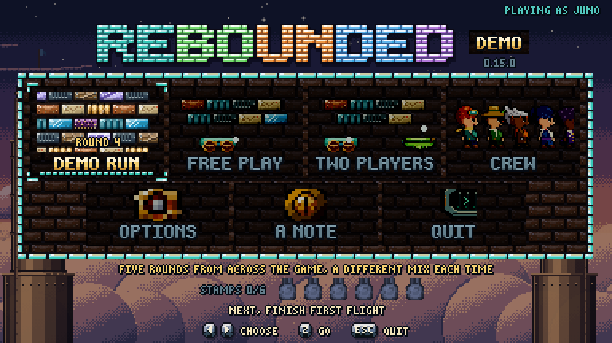
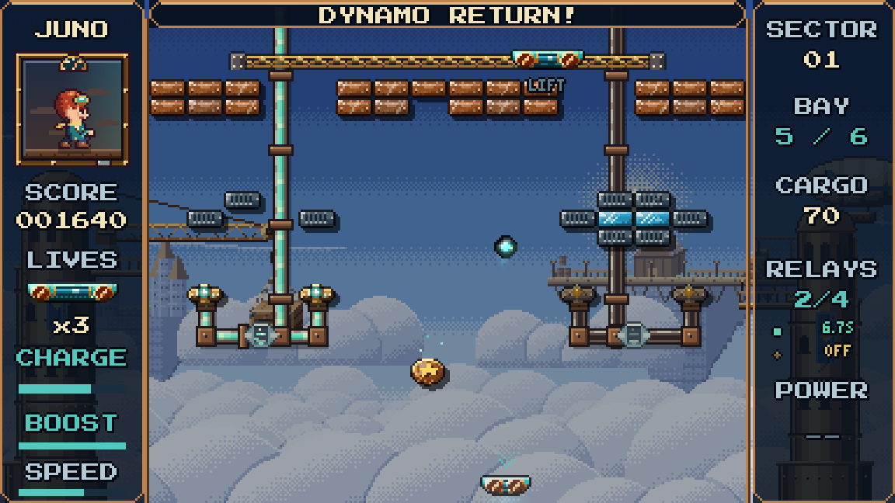

# REBOUNDED: Demo

An original arcade brick breaker with living water, two-screen stages, wardens that fight back and a crew of heroes,
each with an ability of their own.

**The full game is coming soon. [Watch the official trailer.](https://www.youtube.com/watch?v=m6izhJHy3II)**

## Download and play (Windows)

**[Download the demo installer](https://github.com/Tracedicky/AVENGIS-Rebounded-Demo/releases/latest)**: open the
latest release and click `AVENGIS-Rebounded-Demo-0.13.1-Setup.exe`, then run it. Already have the old demo? This
upgrades it in place, saves and all.

Windows may show a blue "Windows protected your PC" box, because the installer isn't code-signed. Click
**More info**, then **Run anyway**. It installs just for you (no administrator needed), with Start menu shortcuts and
an optional desktop one.

## What's in it

- **The demo run:** five rounds dealt from the whole game, a new mix every time: a world's stage, then Endless,
  Mosaic and the Flood in a shuffled order, then a warden to finish. Your score and lives carry through, and the best
  runs go on the demo's own high-score table.
- **Free play:** try any part on its own: First Flight (the basics), a stage from every world, the wardens, Endless,
  Mosaic, the Flood and a taste of the Expedition.
- **Two players** on one PC: the demo run in co-op, versus against the CPU or a friend, and Twin Colours.
- **The crew:** all five heroes, each with an ability of their own.
- **Six stamps** to collect along the way.

## What's new in 0.13.1

- **The Crane Climb's wall moves:** three gapped rows sliding opposite ways, so the way out is a gap to time.
- **Endless:** every way's world is drawn at random, and a round's two ways are never the same world.
- **No stage loses bricks before you serve:** the water a stage starts with breaks nothing until it has come to rest.

## What was new in 0.13.0

- **Stone stairs:** every tap now spills down a stair in its world's own stone, and the basins fill three times as
  fast.
- **The conveyor bar** lets the water run through its gaps instead of walling it off.
- **The falls glimmer**, the R capsule's **SURGE** pours in a fill, and the hints and tips have been put right
  throughout.

## What was new in 0.12.0

- **Living water in every stage:** the left valve fills it, the right one drains it, and your deck rides it up.
- **Waterfalls:** fine falls pour from taps in every world, and your ball swishes through them.
- **Two screens tall:** every stage now has a second screen, and each world ends in an escape from the rising flood.
- **Living wardens:** the bosses are living things now, each with three shapes.
- **Every brick redrawn**, First Flight and the early stages opened up, and droplets that look like droplets.

## What was new in 0.11.0

- **A whole new demo**, built around the demo run: a different game every time you play.
- **All five heroes** to fly: Rook and Mira have joined Juno, Rowan and Nell.
- **Two players**: co-op, versus and Twin Colours, side by side on one PC.
- **Endless and Mosaic**, new to the demo.
- **The last bricks aid:** a board's last few bricks are marked, and if one hides from you, your next return is shown
  (turn it off in Options).
- **Music from the trailer** on the menus.

## Controls

| | Keyboard and mouse | Controller |
|---|---|---|
| Steer | arrows, WASD or the mouse | stick or d-pad |
| Serve, and your hero's ability | Z, Space or click | A |
| Boost | hold X | X |
| Pause menu | P or Esc | Start |
| Full screen | F11 | |

Two players on one keyboard: player one steers with A / D and serves with Z or Space; player two uses the arrows and
Enter. A second controller works too.

The demo keeps its own saves (`%LOCALAPPDATA%\AVENGIS\Rebounded Demo`) and never touches anything else. Uninstall it
from Windows Settings > Apps; it asks before removing your saves.

If it ever crashes, it says so on screen and saves a report in `%LOCALAPPDATA%\AVENGIS\Rebounded Demo\logs`
(closing that screen opens the folder). Please send the report over: it shows exactly what went wrong.

Made by AVENGIS. Any feedback is truly appreciated: thank you for playing!
